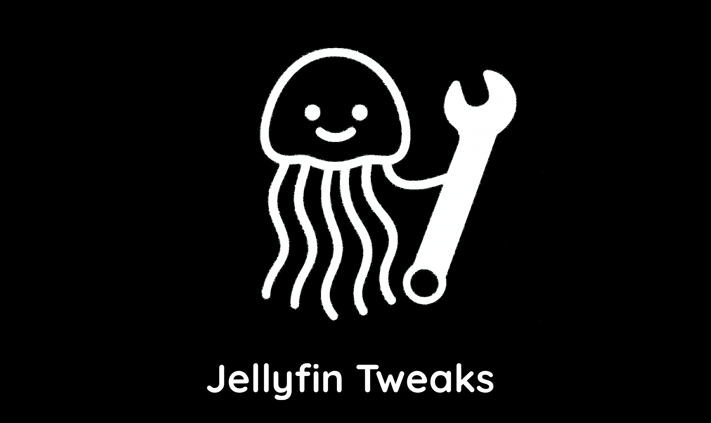

Jellyfin Tweaks - Jellyfin Plugin
====================

<p align="center">
  
  
  
  <a href="https://github.com/n00bcodr/JellyfinTweaks/actions/workflows/check-upstream-settings.yml"></a>
  <br>  <br>
  
  
  <br>  <br>
  <a href="https://discord.com/channels/1381737066366242896/1442128048873930762"></a>
  <br>  <br>
  
</p>
<br>


## About
Jellyfin Tweaks lets an admin set sensible defaults for every user from one settings page, so nobody has to dig through each client's settings. It is built on top of [gaam24/JellyTweaks](https://github.com/gaam24/JellyTweaks/) with more tweaks from [jellyfin-mods](https://github.com/BobHasNoSoul/jellyfin-mods).

Every setting is **opt-in**. Leave it on "Don't manage" and users keep control of it. A single **Disable Jellyfin Tweaks** switch turns everything off without uninstalling.

## 🔧 Tweaks
The settings page is split into tabs, and each setting is tagged **Server** or **Browser** (see [How it works](#how-it-works)).

| Tab | What you can set |
|---|---|
| **Display** | Language and date/time locale, desktop and mobile display mode, app theme, backdrops, details banner, screensaver, library page size, Next Up options |
| **Home** | Home screen sections, library order, which libraries show on the home screen, library folder grouping, default screen per library |
| **Playback** | Audio and video quality, bitrate limits, transcoding codecs, DTS/TrueHD/Hi10P, remux behavior, next-episode autoplay, cinema mode, theme music/videos |
| **Subtitles** | Subtitle language and mode, burn-in, PGS rendering, subtitle appearance |
| **Controls** | Gamepad, smooth scroll |
| **Live TV & Guide** | Guide indicators, color-coded backgrounds, channel order, favorites at top |
| **Sorting** | Default sort field and order per library, picked from your server's real libraries (no IDs to enter) |
| **Other** | Auto login, local-network sign-in without password, preferred aspect ratio, show remaining time |

## ✅ Compatibility

### Server
| Jellyfin | Plugin build | Status |
|---|---|---|
| 12.x | `Jellyfin.Plugin.JellyTweaks_12.0.0.zip` (.NET 10) | ✅ Supported |
| 10.11.x | `Jellyfin.Plugin.JellyTweaks_10.11.0.zip` (.NET 9) | ✅ Supported |

The catalog installs the right build for your server automatically.

### Clients
Tweaks are applied by a script that runs inside the Jellyfin **web client**, so a client only gets them if it loads the web client *from your server*.

| Client | Status | Notes |
|---|---|---|
| Web browsers (desktop and mobile) | ✅ Supported | |
| LG webOS app | ⚠️ Partial | Loads the server's web client, so the script runs. The desktop/mobile display mode is skipped on TVs |
| Samsung Tizen app | ❌ Not supported | The app bundles its own copy of the web client and never loads the script |
| Native apps (Android TV, Swiftfin, Findroid, Streamyfin, Infuse, ...) | ❌ Not applicable | They don't use the web client |
| Jellyfin Desktop / Android app | ❔ Untested | Wrap the web client; may work |

> [!NOTE]
> **Server** settings are stored on the server, but only the web client writes them, and only when a user opens it. A user who never opens the web client (for example someone who only uses the Tizen app) never gets them. Whether another client honors a stored setting depends on where it is stored, see [Where Server settings are stored](#where-server-settings-are-stored). **Browser** settings only affect the browser or device they were applied on.

## How it works
- The plugin adds a small loader `<script>` to the web client's `index.html` **at request time**. It never edits `index.html` or the web bundle on disk, which avoids the permission problems of file-patching on Docker installs.
- When a user opens the web client, the script fetches the plugin's public configuration and applies it:
  - **Server** settings are written through the Jellyfin API (user configuration and display preferences, e.g. audio/subtitle defaults, library order, home sections, sort order).
  - **Browser** settings are written to the browser's local storage (e.g. display mode, backdrops, playback toggles).
- This runs every time the web client loads, so a forced value stays forced.

### Where Server settings are stored
| Stored as | Settings | Read by |
|---|---|---|
| **User configuration** | Audio/subtitle language and mode, play default audio track, remember selections, next-episode autoplay, hide played in Latest, show missing episodes, local-network sign-in without password, library order, home screen library excludes, library folder grouping | Jellyfin clients generally (not verified per client) |
| **Web display preferences** (`usersettings`) | Sort order, home screen sections, default screen per library, skip back/forward length, dashboard theme, guide and Live TV options, episode images in Next Up | The web client; other clients keep their own display preferences and likely ignore these |

## ⚙️ Installation

1. In Jellyfin, go to **Dashboard** > **Plugins** > **Repositories**.
2. Click **➕** and add the repository:

> [!NOTE]
> ```
> https://raw.githubusercontent.com/n00bcodr/jellyfin-plugins/main/manifest.json
> ```

3. Click **Save**.
4. Go to the **Catalog** tab, find **Jellyfin Tweaks** in the list, and click **Install**.
5. **Restart** your Jellyfin server to complete the installation.

## 🐞 Reporting issues
Please include your Jellyfin server version, the client you're using (browser, TV app, ...), and the browser console output (look for lines starting with `[JellyTweaks]`).

---

<div align="center">

**Made with 💜 for Jellyfin and the community**

### Enjoying Jellyfin Tweaks?

Checkout my other repos!

[Jellyfin-Enhanced](https://github.com/n00bcodr/Jellyfin-Enhanced) (javascript) • [Jellyfin-Elsewhere](https://github.com/n00bcodr/Jellyfin-Elsewhere) (javascript) • [Jellyfin-Tweaks](https://github.com/n00bcodr/JellyfinTweaks) (plugin) • [Jellyfin-JavaScript-Injector](https://github.com/n00bcodr/Jellyfin-JavaScript-Injector) (plugin) • [Jellyfish](https://github.com/n00bcodr/Jellyfish/) (theme)


</div>
